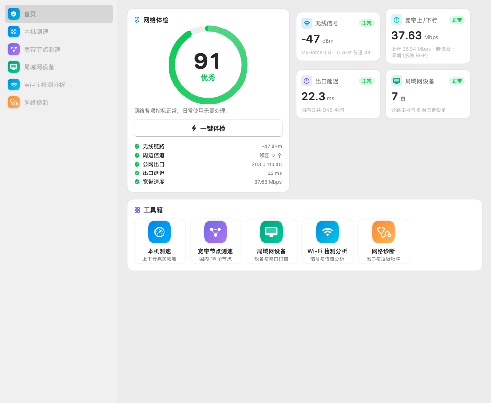
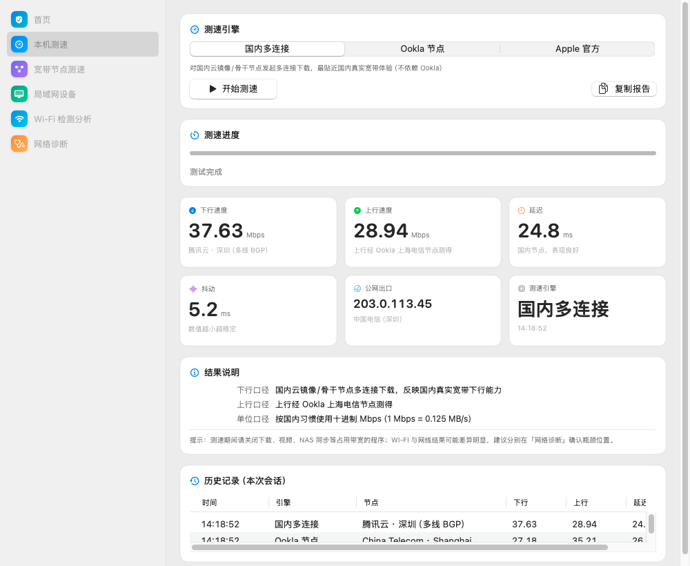
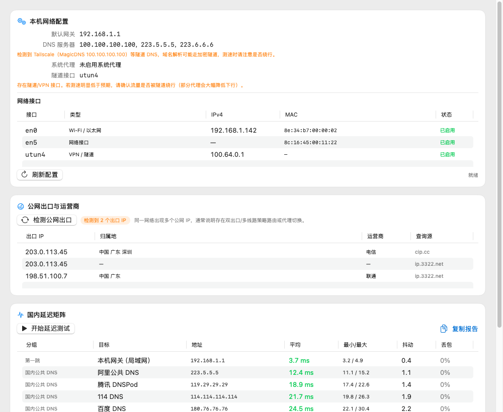
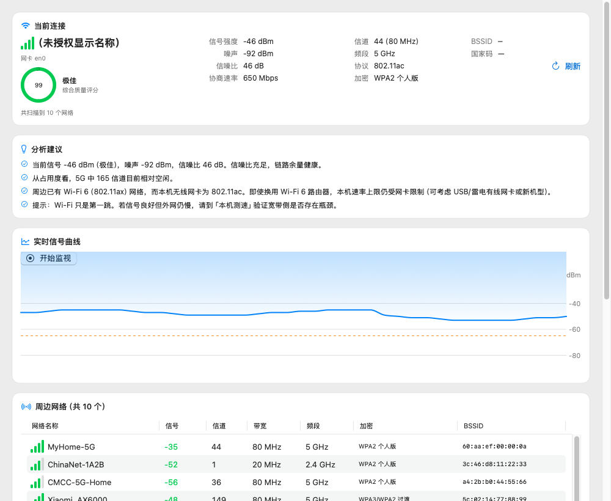
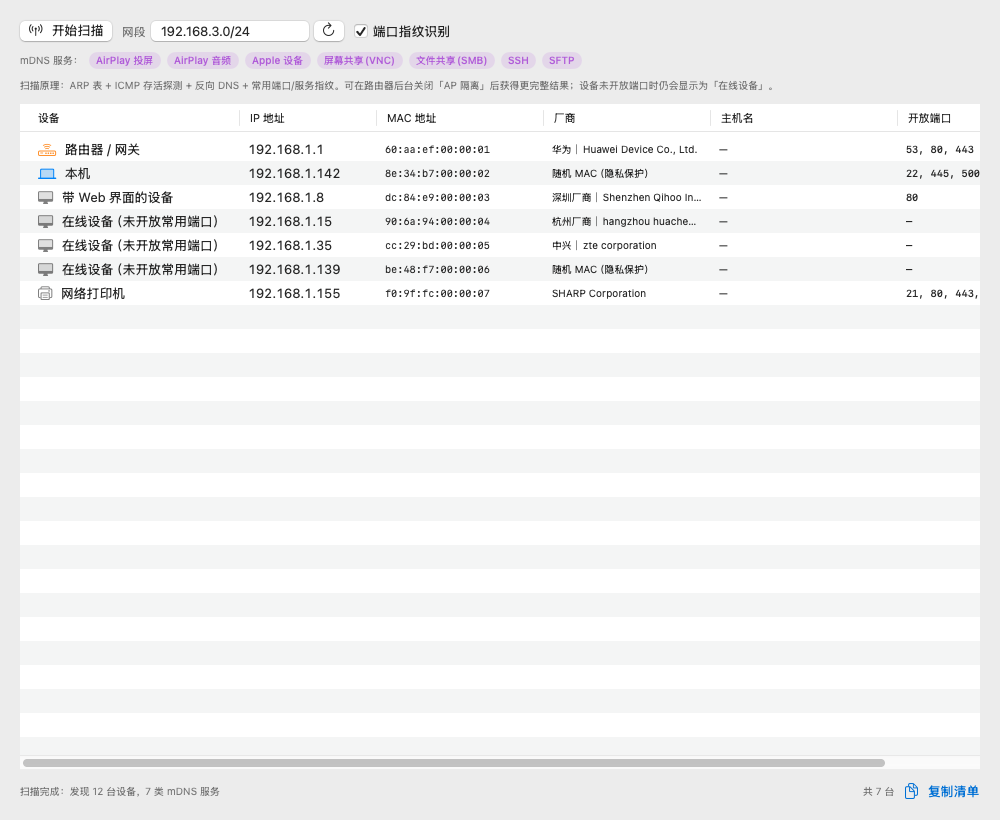

# NetCheck · 网络体检

> **面向中国大陆网络环境的 macOS 原生网络体检工具。** 本机真实上下行测速 · 国内节点测速 · 局域网设备扫描 · Wi-Fi 信号分析 · 网络诊断，一个窗口全包。纯本地测量，**零遥测、不上报任何数据**。

<p align="center">
  <a href="../../releases/latest"></a>
  <a href="../../actions/workflows/build.yml"></a>
  <a href="LICENSE"></a>
  <b>简体中文</b> ｜ <a href="README.en.md">English</a>
</p>

<p align="center">
  
</p>

---

## 为什么做这个

市面上的测速 App 在中国大陆用起来有三个明显不适配的地方，这个项目就是针对它们做的：

| 痛点 | 本项目的做法 |
|---|---|
| 境外测速 App 的节点全在境外，测出来是"翻墙速度"，不是宽带真实速度 | 内置 **16 个国内节点**（云厂商镜像 + 高校教育网镜像 + Ookla 上海电信），逐节点探测后限时多连接下载；失败会**如实归因**（WAF 拦截 / 重定向 / 反爬挑战页 / 节点不可达 / 极慢），不把节点问题说成你的网络问题 |
| 只有测速，没有局域网和 Wi-Fi 分析 | 内置**局域网设备扫描**（ARP + ICMP + 反向 DNS + 端口指纹 + mDNS，IEEE 54204 条厂商库离线识别）与 **Wi-Fi 检测分析**（信号 / 噪声 / 信噪比 / 信道拥塞 / 邻区 / 加密方式） |
| macOS 15 上 `airport` 命令已失效，很多老工具扫不到 Wi-Fi | 直接调用 **CoreWLAN 原生框架**，信号、信道、带宽、噪声全部可读 |

另外还修了同类工具常见的一处"惯性误判"：**同一台机器在无定位权限时，只能可靠识别「开放网络」与 WEP**——本工具绝不把加密网络误报成开放，其余如实标注"已加密·需定位权限"。

## 功能

<p align="center">
  
  
</p>

| 页面 | 内容 |
|---|---|
| **首页 · 一键体检** | 圆形体检评分（0–100，七项加权，**未测项目不参与加权**不虚高）+ 一键跑完无线链路→信道环境→公网出口→延迟→上下行带宽 + 可优化项清单 |
| **本机测速** | 真实上/下行、延迟、抖动、公网出口；三引擎可选（国内多连接 / Ookla 节点 / Apple 官方 `networkQuality`）；实时速率曲线、随时停止（⌘.）、历史记录一键复制报告 |
| **宽带节点测速** | 16 个国内节点一键全测（3 并发），自动排序标记最优；每个失败节点给出**可行动的准确原因** |
| **局域网设备** | ARP + ICMP 存活探测 + 反向 DNS + 28 个端口指纹 + mDNS 服务发现，识别设备类型与厂商（3.2 秒扫完 /24） |
| **Wi-Fi 检测分析** | 信号 / 噪声 / 信噪比 / 信道 / 带宽 / 协议 / 加密 + 质量评分 + 实时信号曲线 + 2.4G/5G 信道占用图 + 中文优化建议 |
| **网络诊断** | 网关 / DNS / 代理 / 隧道识别 + 国内接口查公网出口（自动识别多出口）+ 10 项国内延迟矩阵 |
| **菜单栏实时网速** | 常驻显示 `↓x.x ↑x.x`，每秒采样默认网卡收发字节——不测速也能看到真实流量 |

<p align="center">
  
  
</p>

## 下载安装包（不想自己编译就用这个）

到 **[Releases](../../releases/latest)** 下载 `NetCheck-v1.2.0-macos-universal.zip`（约 2.8 MB，**通用二进制**，Intel 与 Apple Silicon 都能跑），解压后把「网络体检.app」拖进「应用程序」即可。

由于本软件是免费开源项目，采用 ad-hoc 签名、**未经 Apple 公证**（公证需每年 99 美元的开发者账号），首次打开时 macOS 会提示"无法验证开发者"。解决办法（任选其一）：

```bash
# 方式一：右键点击 App → 打开 → 弹窗里再点"打开"（之后可正常双击）
# 方式二：一行命令去掉隔离标记
xattr -dr com.apple.quarantine "/Applications/网络体检.app"
```

每个 Release 都附带 `SHA256SUMS.txt`，可用 `shasum -a 256 <文件>` 校验下载完整性。压缩包内另含 `安装说明.txt`。

## 构建与运行

**要求**：macOS 13+（在 15.8 上验证）、**Xcode Command Line Tools**（提供 `swiftc`，无需完整 Xcode）

```bash
git clone https://github.com/able12138/NetCheck.git
cd NetCheck
./build.sh                          # 产出 build/网络体检.app
open "build/网络体检.app"

# 若要装进「应用程序」
cp -R "build/网络体检.app" /Applications/
```

**可选依赖**（缺失时会自动降级，不影响主功能）：

| 依赖 | 用途 | 安装 |
|---|---|---|
| `speedtest`（speedtest-go） | Ookla 节点测速与上行测速通道 | 见 [speedtest-go releases](https://github.com/showwin/speedtest-go/releases)，取 `Darwin_x86_64`/`Darwin_arm64` 解压后放进 `/usr/local/bin` |
| `fping` | 局域网存活探测加速（无则回退系统 ping） | `brew install fping` |
| `curl` | 节点探测与测速文件校验 | 系统自带 |

## 内置自检工具（让结论可复验）

这个项目里每个"结论"都配了能重跑的验证脚本，而不是只写在文档里：

| 工具 | 用途 |
|---|---|
| `./tools/selftest.sh` | 命令行自检：真实跑 Wi-Fi / 节点 / 局域网 / 诊断各引擎 |
| `./tools/nodetest.sh [秒数]` | 节点目录真实复验：16 个节点全跑一遍，输出状态 / 速度 / **失败归因汇总** |
| `./tools/perfcheck.sh` | 响应性自测：主线程排队延迟 + 测速回调频率（判断界面卡不卡） |
| `./tools/uishot.sh <目录>` | 离屏渲染六个界面为 PNG（用 `ImageRenderer`，**不需要屏幕录制权限**） |
| `./tools/update-oui.sh` | 从 IEEE 官方下载并合并最新 OUI 厂商数据 |

## 实测结果（可直接复现）

- **本机测速**：下行 37–46 Mbps / 上行 23–35 Mbps / 延迟 24 ms（国内电信家宽，腾讯云 + Ookla 上海电信交叉验证）
- **节点可用性**：16 个国内节点中稳定 **7–8 个可用**（腾讯云、Ookla 上海电信、清华 TUNA、华中科大、齐鲁工大、北京外国语、网易）
- **局域网**：自动识别网段，3.2 秒发现 12 台设备并识别厂商
- **Wi-Fi**：802.11ac / 5GHz / 80MHz / 585 Mbps 协商速率，信号 −47 dBm、噪声 −93 dBm、SNR 46 dB
- **响应性**：Wi-Fi 扫描期间主线程最大排队 **1670 ms → 0 ms**；测速进度回调 **53.5 次/秒 → 4.2 次/秒**

> 详细的逐项实测记录、失败归因表与设计取舍，见 **[使用说明.md](使用说明.md)**（第十节：节点测速失败归因）。

## 隐私说明

- **所有测量都在本机完成**，程序不向任何自建服务器上报数据。发出的网络请求只有两类：① 公开测速源（国内镜像站大文件 / Ookla 节点）；② 公开 IP 归属查询接口（`cip.cc`、`ip.3322.net`、`myip.ipip.net`、`api.ipify.org`）。
- **不含任何统计、埋点、账号体系**。
- 仓库内的截图与示例数据**全部为合成数据或文档示例值**：IP 使用 RFC 5737 保留段（`203.0.113.x` / `198.51.100.x`），Wi-Fi 名称与 MAC 为虚构值（保留厂商 OUI 前缀以便演示厂商识别）。
- 本工具会读取你的 Wi-Fi 名称与局域网设备信息用于**本地展示**，这些信息不出机器。

## 已知限制

- **Wi-Fi 名称（SSID/BSSID）与精确加密类型**：macOS 14 起必须授予**定位权限**才能读取，未授权时显示"名称隐藏"，邻区加密只能可靠区分"开放 / WEP / 已加密"。
- **上行测速**：国内没有公开的上传测速接口，依赖 Ookla（上海电信）通道；回退到 Cloudflare 时会标注"跨境仅供参考"（会低估国内上行）。
- **镜像节点可用性波动极大**：同一节点不同时段实测结果可能相差两个数量级（例如清华 TUNA 实测 0.06–42 Mbps 都出现过）。判断宽带真实能力请看**腾讯云**与 **Ookla 上海电信**这两个稳定节点。
- **不会**修改系统设置、不做"网络优化/一键加速"这类无法验证的操作。

## 技术要点

- **纯 Swift + SwiftUI，用 `swiftc` 直接构建**（不依赖 Xcode 工程文件、不依赖 Electron/Tauri），单文件脚本 `build.sh` 一键出 `.app`
- **Wi-Fi**：CoreWLAN（`CWWiFiClient`）原生扫描；`airport` 在 macOS 15 已失效
- **测速**：`URLSession` 多连接并发下载 + 限时采样，Range 不支持时自动回退整段下载
- **节点探测**：单次 `curl` 同时取回「跟随重定向后的最终地址 + 状态码 + 实收字节 + 响应头」，据此区分 WAF 拦截（`418` + `X-Hwwaf-Attack-Id`）、反爬挑战页（`cerberus-sec: CHALLENGE`）、返回网页而非文件、重定向环、节点不可达
- **响应性**：CoreWLAN/子进程调用全部移出主线程，测速回调限频，用"主线程排队延迟"量化而非凭感觉

## 开发环境

本项目在以下环境开发与验证：macOS 15.8.1 · Intel i9-9980HK / 32GB · swiftc 6.2.4（Command Line Tools，未安装 Xcode）。Intel 与 Apple Silicon 均可构建（`build.sh` 会自动读取本机架构）。

## 第三方数据与致谢

- **IEEE OUI 数据**（`resources/ieee-oui.txt`）：来自 IEEE 官方公开的 OUI 注册表，用于离线识别网卡/设备厂商；可用 `./tools/update-oui.sh` 更新。版权归 IEEE 所有。
- **测速源**：腾讯云、清华 TUNA、华中科大、齐鲁工大、北京外国语、网易等公开镜像站，以及 Ookla 公共测速节点。本项目只下载公开的大文件用于测速，不存储任何下载内容。
- 交互习惯上参考了同类 macOS 网络工具的通用做法；**未复制任何第三方代码**。

## License

[MIT](LICENSE) © 2026 able12138

---

English documentation: **[README.en.md](README.en.md)**

---

## 持续集成

`.github/workflows/build.yml` 在每次 push / PR 时于 GitHub 的 macOS runner 上执行：

1. `./build.sh --universal` —— 构建 Intel + Apple Silicon 通用二进制
2. 断言产物同时含 `x86_64` 与 `arm64` 两个架构切片
3. `./tools/uishot.sh` —— 离屏渲染全部六个界面（可捕获 SwiftUI 运行时崩溃，无需屏幕录制权限）
4. 打包为 zip 并上传 artifact；**推送 `v*` 标签时自动创建 Release 并附上安装包与 `SHA256SUMS.txt`**
